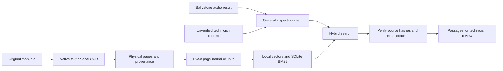

# RAG architecture

[Overview](../README.md) - [Code reference](code/README.md)

## Ownership and boundary

Ballystone's `scripts/` implements acoustic extraction, training and inference.
Its original files and trained assets are unchanged. `audio_bridge.py` calls
`scripts/predict_audio.py` in a child process, passing a recording path, family,
ID and temporary JSON output. It prepares local native-library paths, checks
the frozen bundle checksum and adapts field names such as `anomaly_flag` to
`is_anomaly`. Uploaded bytes become a temporary WAV that is removed afterward.
It does not implement audio features, scores, training or thresholds.

## Document pipeline

Extraction preserves physical page numbers, printed labels, coordinates, exact
text and PDF/text hashes. A checksum-specific column profile handles the scanned
guide. Original PDFs remain unchanged; searchable OCR copies are derivatives.
Manifest directory paths and browse links are relative for portable checkouts.
Unproofread OCR, blanks and review-flagged pages are excluded from default search.

Chunks are exact single-page substrings with offsets. Limits are 480 model
tokens including the prefix, 350 words and up to 40 overlapping words. They are
not LLM summaries or translations.

The quantized local `Xenova/multilingual-e5-small` model is pinned to revision
`761b726dd34fb83930e26aab4e9ac3899aa1fa78`. It uses `query: ` and `passage: `
prefixes, masked mean pooling and L2 normalization for 384-dimensional vectors.
Python tokenization and a local Node ONNX CPU worker avoid remote inference.
The query encoder is downloaded separately; prepared document vectors are in Git.

Family/language filters apply before combining cosine search and SQLite FTS5
BM25 with equal-weight reciprocal rank fusion (constant 60). Results contain at
most one passage per page. The cosine cutoff of 0.82 was tuned on development
questions; it is not a confidence probability. Automatic language labels are
heuristic and unknown/mixed pages remain eligible.

Retrieval verifies exact text/offsets, citation metadata, original PDF hashes
and index/tokenizer checksums. Family hints and generic bearing references do
not establish manufacturer/model applicability.

## Connected analysis

`analyze_recording()` builds a query from the machine family, general intent
from the original anomaly flag and supplied technician context. It does not
insert raw scores or artificial dataset IDs into query text or infer a fault
category. JSON separates measured audio, unverified context, query, retrieval,
interpretation and timings. Empty supported evidence stays empty; retrieval
failure preserves audio under `audio_only` with an explicit error.

Source-cited LLM reports and a technician editing/approval/history interface
remain pending. Publishing manuals to Git is not permission to send them or
queries to an external LLM. A technician must validate guidance against the
actual equipment; an anomaly is not a confirmed mechanical diagnosis.
